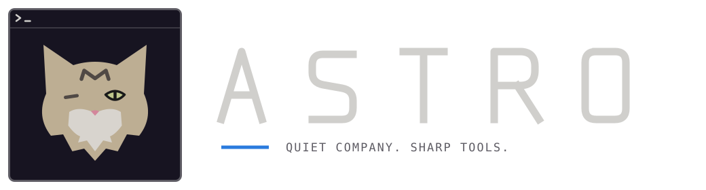

# Astro



Astro turns [kitty](https://sw.kovidgoyal.net/kitty/) into a workspace for
agent CLIs such as Claude Code, Codex and Hermes. It is not a fork of kitty's
source code: it is a configuration plus a title-bar extension that runs inside
an unmodified kitty.

## Features

**Meet Astro**

The mascot is based on Astro, a real long-haired brown/grey tabby: tall ears,
a dark forehead M, a pink nose and a cream ruff. In the owner's front-facing
reference, the missing/closed eye is on the viewer's left and the single open
pale green eye is on the viewer's right. The icon and both ASCII cat poses keep
that exact orientation; do not mirror them. The simplified icon uses eight bold
shapes rather than detailed whiskers, cheek stripes or decorative marks.
The app icon and outlined wordmark share the terminal's existing Gruvbox palette.
Reference photographs are personal and are not distributed in this repository.

New Bash terminal panes greet you with a short CPU-only ASCII animation:
First contact, Tabby rain, Constellation, Orbital cat, Cat nap, Zoomies,
Purr waves, Yarn physics, Whisker radar or Stardust. A persistent shuffle bag
shows all ten before repeating, including when several panes open together.
The greeting lasts at most
1.25 seconds, disappears without adding scrollback, and stops as soon as you
type; your input is left in the terminal queue for the shell. Descendant Bash
shells skip the greeting in the same pane. Direct non-shell command launches,
tiny panes, redirected output and `TERM=dumb` skip it too. Bash remains the
normal login shell, preserving kitty's native shell integration.

```sh
# Disable greetings for terminals started from this environment.
export ASTRO_ANIMATION=off
# Alternatively set `env ASTRO_ANIMATION=off` in kitty.conf.
# REDUCE_MOTION=1 also disables them; NO_COLOR disables their colors.

# List or preview a specific effect (1–10).
python3 ~/.config/kitty/astro_intro.py --list
python3 ~/.config/kitty/astro_intro.py --effect 6 --duration 3
```

**Astro Bash prompt**

The familiar `user@host:path$` layout uses pale eye green for the username and
prompt symbol, warm fur taupe for the host, cream for the directory, and muted
separators. This is scoped to interactive Kitty Bash sessions; other terminals
are unchanged. Readline wrapping and kitty's native shell integration remain
intact. Set `ASTRO_PROMPT=off` to keep your existing prompt; `NO_COLOR` or a dumb
terminal selects a plain prompt. To update an already open Bash shell, run:

```sh
source ~/.config/kitty/astro_prompt.bash
```

**Pane controls in every title bar**

| Control | Action |
| --- | --- |
| `+→` / `+↓` | Open a terminal to the right / below in the current directory |
| `✧↓` | Open Codex below, sized to six rows |
| `▦` | Cycle the pane's group: none → 1 → 2 → 3 → 4 → none (colored) |
| `\|↔\|` | Give every pane of this group the same width |
| `⇕` | Give every pane of this group the same height |
| copy | Copy the selection |
| `>_` | Copy the last shell command with its output |
| keyboard | Show kitty's keyboard shortcuts in a separate tab |
| zoom | Zoom the pane (stack layout) and back |
| `✕` | Close the pane (asks when a job is running) |

- **Groups:** equalizing changes only the panes of the clicked pane's group;
  every other pane keeps its size. On an ungrouped pane the buttons equalize
  the whole tab along that axis only.
- **Folding:** when the title would otherwise be cut, all controls except close
  fold behind `‹`. Click it to unfold; the controls stay open until you click
  the fold button again. Moving the pointer away does not close them.
- **Hover hints:** the title bar describes the control under the pointer.
  Hints are English or German, following the system locale; put `de` or `en`
  into `~/.config/kitty/pane_controls_lang` to pin a language.

**Agent-aware panes**

- Panes running `claude`, `codex` or `hermes` get a colored badge
  (✻ Claude, ›_ Codex, ☤ Hermes). Codex session ids give way to the working
  directory.
- A red dot marks a pane whose program rang the bell (an agent finished or
  waits for input); `•` marks background output since the pane last had focus.

**Configuration** (`config/kitty.conf`)

- Splits layout with proportional sizing, a 3 × 3 agent workspace session
  (`config/sessions/default.conf`) plus a monitor column.
- Gruvbox colors, rounded tabs (shown from two tabs on), dimmed inactive panes,
  beam cursor with a short trail, hover-only link underlines.
- Desktop notification when a long shell command finishes in an unfocused
  pane; trailing spaces are stripped when copying from TUIs.
- **Right click:** paste a PNG screenshot copied by Flameshot as a quoted file
  path into the clicked pane; otherwise paste clipboard text. Agent CLIs can
  read the image at that path. This does not emulate a native image attachment.
- **Middle click:** paste the primary text selection, including in mouse-aware
  TUIs. Both mouse bindings take precedence over application mouse handling.
  Ctrl+Shift+V keeps kitty's native clipboard behavior.

Screenshots stay in `${XDG_CACHE_HOME:-~/.cache}/astro/clipboard` with private
permissions. They are not automatically deleted, so earlier pasted paths keep
working; delete old screenshots there manually when no longer needed. The
clipboard itself is never replaced. PNG extraction requires `wl-paste`
(`wl-clipboard`) in a Wayland desktop, or `xclip` in a pure X11 session.

## Tests

Run the tests with kitty's Python runtime (the kitten imports kitty APIs):

```sh
kitty +runpy 'import unittest; r = unittest.TextTestRunner(verbosity=2).run(unittest.defaultTestLoader.discover("tests")); raise SystemExit(not r.wasSuccessful())'
```

## Requirements

- Python **3.10+** and Bash for the optional startup greetings; the renderer
  uses only the standard library and does not use the GPU.
- kitty **0.49.2**. The title-bar mouse handler, `Window._title_bar_screen`
  and the splits layout internals are not public APIs; check Astro after every
  kitty upgrade.
- Linux with kitty on X11 (`linux_display_server x11`, also under Xwayland).
  On native Wayland everything except the hover hints works.
- Optional: Python 3 with [fontTools](https://github.com/fonttools/fonttools)
  to rebuild the icon font.

## Install

```sh
git clone https://github.com/itmitalles-de/astro.git
cd astro
./install.sh
```

The installer copies `config/` into `~/.config/kitty` (or
`$KITTY_CONFIG_DIRECTORY`), backs up replaced files, installs the icon font,
Astro's desktop entry, application icons and `~/.local/bin/astro`. It adds one
managed, Kitty-only source block to `~/.bashrc` (backed up first). It keeps your
shell and aliases unchanged, applies Astro's prompt palette only in Kitty, and
does not modify other terminal emulators. For a staged
install, set `KITTY_CONFIG_DIRECTORY`, `XDG_DATA_HOME`, `ASTRO_BIN_DIRECTORY`
and `ASTRO_BASHRC` to staging paths.

Open **Astro** from the application launcher, or run `astro`. At each app
start, the launcher copies the literal `/resume` (without a newline) into the
clipboard and primary selection. Opening another pane or tab does not overwrite
the clipboard again. Clipboard failure never prevents the terminal from opening.
New Kitty processes use `kitty.app.png` as their window icon. Existing processes may
need a restart before their icon changes; no running sessions are closed by
the installer.

## Brand assets

`assets/astro.svg` is the app-icon source; `assets/astro-logo.svg` is the
self-contained wordmark. PNGs are supplied at 32, 64, 128, 256 and 512 pixels.
Rebuild them with the system Python and PyGObject, Rsvg and Cairo installed:

```sh
/usr/bin/python3 tools/build_brand.py
```

## Icon font

All controls use one outline icon font, `fonts/AstroPaneControls.ttf`
(private use area U+E900–U+E90E). Edit the paths in
`tools/build_pane_icons.py` and rebuild it with:

```sh
python3 tools/build_pane_icons.py fonts/AstroPaneControls.ttf
```

The build is reproducible byte for byte.

## License

Copyright (C) 2026 itmitalles.de

Astro is free software: you can redistribute it and/or modify it under the
terms of the GNU General Public License as published by the Free Software
Foundation, either version 3 of the License, or (at your option) any later
version. See [LICENSE](LICENSE).
